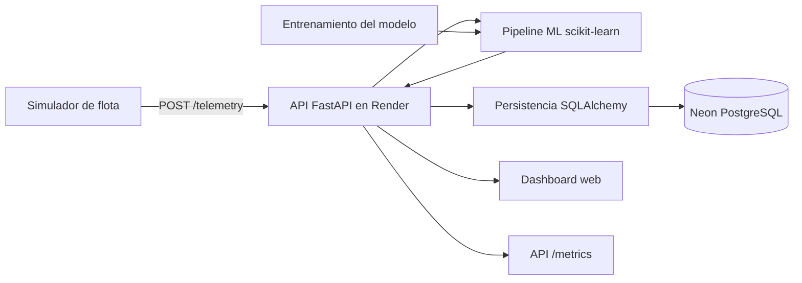

# ACI606 - Cloud Fleet Challenge

Plataforma cloud para recibir telemetría de una flota virtual de robots, guardar mediciones y predicciones, clasificar el estado de cada robot mediante Machine Learning y visualizar la operación desde un dashboard.

## Servicio desplegado

- **Dashboard:** https://aci606-cloud-fleet-challenge-u83o.onrender.com/dashboard
- **Documentación interactiva (Swagger):** https://aci606-cloud-fleet-challenge-u83o.onrender.com/docs
- **Estado del servicio:** https://aci606-cloud-fleet-challenge-u83o.onrender.com/health
- **Métricas:** https://aci606-cloud-fleet-challenge-u83o.onrender.com/metrics
- **Robots registrados:** https://aci606-cloud-fleet-challenge-u83o.onrender.com/robots

## Arquitectura

El simulador funciona como cliente y generador de carga. La plataforma cloud recibe sus mediciones, ejecuta el modelo, guarda los datos y expone la información a través de la API y del dashboard.



### Componentes principales

- **API:** FastAPI y Uvicorn.
- **Persistencia:** SQLAlchemy. En desarrollo local se utiliza SQLite; en Render se utiliza PostgreSQL administrado por Neon mediante la variable de entorno `DATABASE_URL`.
- **Machine Learning:** pipeline de scikit-learn guardado como `models/model.joblib`.
- **Dashboard:** interfaz web disponible en `/dashboard`.
- **Simulador:** genera telemetría para varios robots y puede enviar datos al servicio local o remoto.

## Funcionalidades y endpoints

| Método | Ruta | Función |
|---|---|---|
| GET | `/health` | Comprueba el servicio y muestra cantidad de robots y registros almacenados. |
| POST | `/telemetry` | Recibe una medición, predice su estado y guarda telemetría y predicción. |
| GET | `/robots` | Devuelve la última medición y predicción disponible de cada robot. |
| GET | `/robots/{robot_id}/history` | Consulta el historial de telemetría de un robot. |
| POST | `/predict` | Ejecuta una predicción y guarda la medición junto con el resultado. |
| GET | `/metrics` | Expone solicitudes, errores, latencia promedio, uptime y contadores de persistencia. |
| GET | `/dashboard` | Abre el panel de monitoreo de la flota. |
| GET | `/docs` | Abre la documentación interactiva de la API. |

El modelo clasifica cada observación en uno de tres estados: `NORMAL`, `WARNING` o `CRITICAL`. La respuesta de inferencia incluye robot, estado predicho, confianza, versión del modelo y tiempo de inferencia.

## Machine Learning

### Datos y variables

El entrenamiento utiliza un dataset sintético generado por el simulador. La configuración usada para la versión entregada genera **6.000 observaciones**, distribuidas en **12 flotas independientes**, con **8 robots por flota**.

Variables predictoras:

- `speed`
- `battery`
- `motor_temp`
- `vibration`
- `motor_current`
- `obstacle_distance`

Variable objetivo: `status`, con las clases `NORMAL`, `WARNING` y `CRITICAL`.

Distribución del dataset generado:

| Estado | Registros | Porcentaje aproximado |
|---|---:|---:|
| NORMAL | 2.114 | 35,2 % |
| WARNING | 1.873 | 31,2 % |
| CRITICAL | 2.013 | 33,6 % |
| **Total** | **6.000** | **100 %** |

### Prevención de data leakage

La separación de entrenamiento y prueba se realiza por **flotas completas**, no por filas al azar. Con ello, los registros de una flota que queda en Test no aparecen en Train.

- **Train:** 4.500 observaciones de 9 flotas.
- **Test:** 1.500 observaciones de 3 flotas no vistas.
- La validación cruzada también utiliza grupos de flotas mediante `GroupKFold`.

### Comparación y selección

Se compararon dos clasificadores usando F1 macro en validación cruzada:

| Modelo | F1 macro promedio (CV) | Desviación estándar |
|---|---:|---:|
| Regresión Logística | **0,9345** | 0,0165 |
| Random Forest | 0,9270 | 0,0195 |

Se seleccionó **Regresión Logística** porque obtuvo el mayor F1 macro promedio en validación cruzada. El pipeline guarda los pasos de imputación por mediana, escalado estándar y clasificación, para aplicar el mismo preprocesamiento durante la inferencia.

### Evaluación final

En las 1.500 observaciones de Test, el modelo obtuvo:

- **F1 macro:** 0,9250.
- **Exactitud:** aproximadamente 0,94.

Matriz de confusión (filas = estado real; columnas = estado predicho):

| Real \ Predicho | NORMAL | WARNING | CRITICAL |
|---|---:|---:|---:|
| NORMAL | 497 | 39 | 0 |
| WARNING | 18 | 301 | 11 |
| CRITICAL | 0 | 29 | 605 |

El resultado por clase muestra un mejor desempeño en NORMAL y CRITICAL, mientras que WARNING es la clase más difícil de distinguir. La evaluación se realiza sobre flotas separadas que el modelo no utilizó durante el entrenamiento.

## Ejecución local en Windows (PowerShell)

### 1. Clonar el repositorio e instalar dependencias

```powershell
git clone https://github.com/jhoxwe-lgtm/aci606-cloud-fleet-challenge.git
cd aci606-cloud-fleet-challenge

py -m venv .venv
.\.venv\Scripts\Activate.ps1
python -m pip install --upgrade pip
pip install -r requirements.txt
```

Si PowerShell bloquea la activación del entorno, ejecuta lo siguiente en esa misma ventana y vuelve a activar el entorno:

```powershell
Set-ExecutionPolicy -Scope Process -ExecutionPolicy Bypass
.\.venv\Scripts\Activate.ps1
```

### 2. Generar datos y entrenar el modelo

```powershell
python simulator/generate_dataset.py --samples 6000 --robots 8 --fleets 12 --seed 606
python ml/train_model.py
```

Estos comandos generan `data/training.csv`, entrenan y evalúan los clasificadores, guardan el pipeline en `models/model.joblib` y escriben el reporte en `models/training_report.json`.

### 3. Iniciar la API

```powershell
uvicorn app.main:app --host 0.0.0.0 --port 8000 --reload
```

Con la configuración por defecto, los datos se guardan localmente en SQLite, en `data/fleet.db`.

### 4. Conectar el simulador

Abre una segunda terminal, activa el entorno virtual y ejecuta:

```powershell
python simulator/fleet_simulator.py --api http://127.0.0.1:8000 --robots 5
```

Para detener el simulador, utiliza `Ctrl + C`.

### 5. Probar la API

Con la API en ejecución:

```powershell
python tests/smoke_test.py --api http://127.0.0.1:8000
```

También puedes abrir:

- http://127.0.0.1:8000/docs
- http://127.0.0.1:8000/dashboard
- http://127.0.0.1:8000/health
- http://127.0.0.1:8000/metrics

## Despliegue cloud

La aplicación se despliega en **Render** y utiliza **Neon PostgreSQL** para persistencia.

Configuración de Render:

**Build Command**

```bash
pip install -r requirements.txt && python simulator/generate_dataset.py --samples 6000 --robots 8 --fleets 12 --seed 606 && python ml/train_model.py
```

**Start Command**

```bash
uvicorn app.main:app --host 0.0.0.0 --port $PORT
```

Variables de entorno configuradas en Render:

| Variable | Uso |
|---|---|
| `DATABASE_URL` | URL de conexión privada de Neon PostgreSQL. |
| `MODEL_VERSION` | Versión informada por el endpoint de inferencia; actualmente `v1`. |

No se debe publicar el contenido de `DATABASE_URL`, incluir credenciales en el código ni subir archivos `.env` al repositorio.

Para enviar una flota desde un equipo local hacia el servicio cloud:

```powershell
python simulator/fleet_simulator.py --api https://aci606-cloud-fleet-challenge-u83o.onrender.com --robots 5
```

También puedes ejecutar el smoke test contra el servicio remoto:

```powershell
python tests/smoke_test.py --api https://aci606-cloud-fleet-challenge-u83o.onrender.com
```

## Observabilidad

El endpoint `GET /metrics` informa:

- solicitudes de telemetría;
- solicitudes de predicción;
- errores HTTP o excepciones;
- latencia promedio de inferencia;
- tiempo de actividad del proceso;
- robots, mediciones y predicciones almacenadas;
- motor de persistencia activo (`SQLITE_LOCAL` o `POSTGRESQL`).

Los contadores de solicitudes y el uptime corresponden al proceso en ejecución; se reinician cuando la aplicación se reinicia. Los registros de telemetría y predicción permanecen almacenados en la base de datos.

## Estructura del proyecto

```text
aci606-cloud-fleet-challenge/
├── app/
│   ├── main.py
│   └── database.py
├── dashboard/
│   └── index.html
├── ml/
│   └── train_model.py
├── simulator/
│   ├── core.py
│   ├── fleet_simulator.py
│   └── generate_dataset.py
├── tests/
│   └── smoke_test.py
├── data/          # dataset y SQLite locales (generados)
├── models/        # pipeline y reporte ML (generados)
├── requirements.txt
└── README.md
```

Los datos y modelos generados se excluyen de Git mediante `.gitignore`. El dataset y el modelo se vuelven a generar durante el proceso de build de Render, por lo que no es necesario versionar archivos binarios ni datos generados.

## Control de versiones

El desarrollo se trabajó en la rama `feature/ejercicio-4`, con commits descriptivos para las funcionalidades implementadas. La integración final se realiza mediante un Pull Request hacia `main`.
